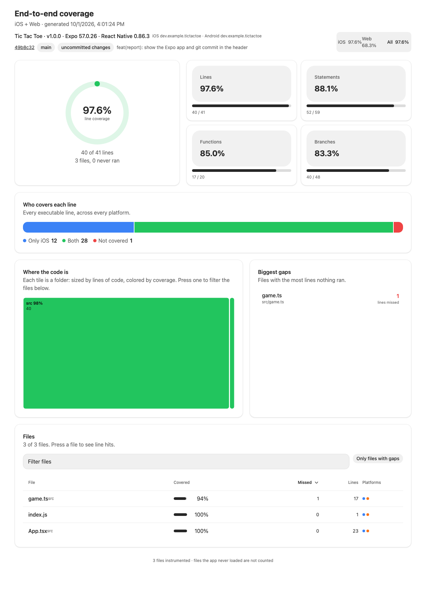

# expo-coverage

**See which lines your end-to-end tests actually run. iOS, Android and web, in one report.**



## Why you'll like it

- **One report for every platform.** A line counts as covered if any platform ran it, and you can see which one.
- **Works with the tests you already have.** Maestro, Playwright, Detox. No rewrites.
- **No changes to your app code.** Everything is off unless `EXPO_COVERAGE=1`, so normal builds are identical.
- **One HTML file.** No server and no network. Open it from disk, attach it to CI, post it in Slack.
- **Agents can fill the gaps.** Ask "which changed lines did no test touch?" and get an answer an agent can act on.

## Quick start

```bash
bun add -d expo-coverage
bunx expo-coverage init                                  # shows the edits, --yes applies them
bunx expo-coverage run -- bunx playwright test           # or: maestro test .maestro
```

```
Coverage  Web 68.3%
28/41 lines · 3 files · 0 never ran
Report    .expo-coverage/report.html
```

Open `.expo-coverage/report.html`. That's the whole loop.

## For agents

```bash
bunx expo-coverage diff origin/main    # lines you changed that no test ran
bunx expo-coverage gaps --top 5        # files with the most untested lines
```

There's also an MCP server (`bunx expo-coverage mcp`). See [docs/agents.md](docs/agents.md).

## Learn more

- [Usage](docs/usage.md): Playwright, Maestro, prebuilt apps, merging platforms
- [CI](docs/ci.md): GitHub Action, thresholds, PR comments
- [CLI reference](docs/cli.md) and [how it works](docs/how-it-works.md)
- [Demo app](examples/tic-tac-toe) with Playwright and Maestro tests
- [Contributing](CONTRIBUTING.md)

## Good to know

- JavaScript only. Native Swift, Kotlin and Java aren't measured.
- Needs an instrumented build. The flag keeps it out of production.
- Screens your tests never load don't appear (they're missing, not 0%).
- Verified on web and iOS. Android uses the same runtime but hasn't been run yet.

MIT © Pay Ready
